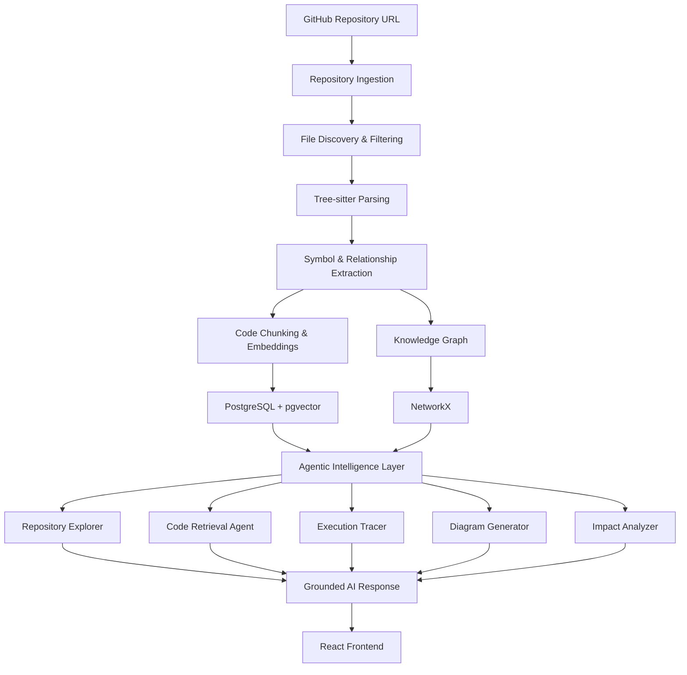

# RepoMind

### AI-Powered Codebase Intelligence Platform

**Understand any codebase. Trace every dependency. Visualize how everything works.**

RepoMind is an AI-powered codebase intelligence platform that transforms public GitHub repositories into structured, explorable knowledge. It enables developers to understand unfamiliar codebases through conversational AI, intelligent code search, dependency analysis, and automatically generated architecture diagrams.

Instead of manually navigating thousands of lines of code, developers can simply provide a GitHub repository URL and ask questions about its architecture, functionality, execution flow, and internal dependencies.

---

## Key Features

- **Multi-Language Code Understanding:** Analyze repositories written in Python, JavaScript, TypeScript, Java, C++, Go, Rust, and other supported languages.
- **Conversational Code Exploration:** Ask natural-language questions and receive context-aware explanations grounded in repository source code.
- **AI-Powered Code Search:** Retrieve relevant functions, classes, methods, and code snippets using semantic, keyword, and structural search.
- **Automated Architecture Diagrams:** Generate Mermaid-based architecture, class, sequence, and execution flow diagrams.
- **Dependency Analysis:** Explore relationships between modules, functions, classes, and components.
- **Execution Flow Tracing:** Understand how requests move through different layers of an application.
- **Change Impact Analysis:** Identify potentially affected components when modifying a function or module.
- **Source-Level References:** Trace AI-generated explanations back to relevant files and code locations.

---

## System Architecture

RepoMind combines structural code analysis, semantic retrieval, knowledge graphs, and agentic AI workflows.



---

## Technology Stack

| Category | Technologies |
|---|---|
| Frontend | React.js, TypeScript |
| Backend | Python, FastAPI |
| Agent Orchestration | LangGraph |
| Code Parsing | Tree-sitter, Python AST |
| Retrieval | RAG, Semantic Search, Hybrid Search |
| Vector Database | PostgreSQL, pgvector |
| Knowledge Graph | NetworkX |
| Database ORM | SQLAlchemy |
| Migrations | Alembic |
| Background Processing | Celery, Redis |
| Visualization | Mermaid.js |
| Containerization | Docker, Docker Compose |
| CI/CD | GitHub Actions |

---

## Agent Architecture

RepoMind uses a centralized orchestration architecture powered by LangGraph, with specialized agents responsible for different code intelligence tasks.

| Agent | Responsibility |
|---|---|
| Repository Explorer | Understand repository structure, metadata, and entry points. |
| Code Retrieval Agent | Retrieve relevant code using hybrid search. |
| Execution Tracer | Trace function calls and dependency paths. |
| Diagram Generator | Generate architecture and execution diagrams. |
| Impact Analyzer | Identify potentially affected components and dependencies. |
| Response Validator | Validate source references, groundedness, and Mermaid output. |

The orchestrator identifies user intent and routes requests to the appropriate tools and agent workflows.

---

## How It Works

1. **Repository Submission:** The user provides a public GitHub repository URL.
2. **Repository Ingestion:** RepoMind retrieves repository metadata and a commit-specific source snapshot.
3. **Code Analysis:** Tree-sitter parses source files and extracts symbols, imports, and relationships.
4. **Knowledge Construction:** Extracted code structures are represented through a knowledge graph.
5. **Semantic Indexing:** Code is divided into meaningful chunks, embedded, and indexed using pgvector.
6. **Agentic Reasoning:** LangGraph orchestrates specialized agents to retrieve and analyze relevant repository information.
7. **Response Generation:** The platform returns explanations, source references, dependency insights, and Mermaid diagrams.

---

## Example Use Cases

**1. Understand an unfamiliar repository**

"What is this project about? Explain its architecture and major components."

**2. Trace application execution**

"Trace how an HTTP request reaches the database."

**3. Understand a specific function**

"Explain how the authenticate() function works and identify its dependencies."

**4. Generate architecture diagrams**

"Generate a Mermaid diagram representing the architecture of this repository."

**5. Analyze change impact**

"If I modify UserService.authenticate(), which other components might be affected?"

---

## Project Structure

```text
repomind/
├── backend/
│   ├── app/
│   │   ├── api/
│   │   ├── core/
│   │   ├── db/
│   │   ├── ingestion/
│   │   ├── analysis/
│   │   ├── indexing/
│   │   ├── graph/
│   │   ├── retrieval/
│   │   ├── agents/
│   │   ├── diagrams/
│   │   └── workers/
│   ├── migrations/
│   └── tests/
│
├── frontend/
│   └── src/
│       ├── components/
│       ├── pages/
│       ├── features/
│       ├── hooks/
│       ├── services/
│       └── types/
│
├── infrastructure/
│   ├── docker/
│   └── scripts/
│
├── docs/
│   ├── architecture.md
│   ├── api.md
│   └── decisions/
│
├── docker-compose.yml
└── README.md
```

---

## Development Roadmap

- [ ] **Phase 1: Repository Ingestion**
  - GitHub URL validation and metadata retrieval.
  - Repository snapshot acquisition.
  - File discovery, filtering, and language detection.

- [ ] **Phase 2: Code Intelligence Engine**
  - Multi-language Tree-sitter integration.
  - Symbol and relationship extraction.
  - Knowledge graph construction.

- [ ] **Phase 3: Semantic Retrieval**
  - Structural code chunking.
  - Embedding generation and pgvector integration.
  - Hybrid code search and source references.

- [ ] **Phase 4: Agentic Intelligence**
  - LangGraph orchestration.
  - Repository-aware conversational AI.
  - Execution flow and dependency tracing.

- [ ] **Phase 5: Visualization & Advanced Analysis**
  - Mermaid diagram generation.
  - Architecture and dependency visualization.
  - Change impact analysis.

- [ ] **Phase 6: Production Readiness**
  - React dashboard.
  - Background indexing and incremental updates.
  - Docker deployment, testing, and CI/CD.

---

## Security & Reliability

RepoMind is designed with repository ingestion security in mind.

- Treat repository content as untrusted input.
- Prevent prompt injection through repository files.
- Validate GitHub URLs and restrict unsafe network access.
- Exclude sensitive files and detect potential secrets.
- Avoid executing untrusted repository code.
- Pin analysis to specific repository commit hashes.
- Validate AI-generated source references.

---

## Getting Started

*Installation and configuration instructions will be added as the implementation progresses.*

Planned prerequisites:

- Python 3.11+
- Node.js
- PostgreSQL with pgvector
- Redis
- Docker and Docker Compose
- LLM API credentials

---

## Project Status

**Status:** Under Active Development

RepoMind is being developed incrementally, beginning with repository ingestion and progressing towards a complete agentic codebase intelligence platform.

Features listed in the roadmap represent planned capabilities and may not yet be implemented.

---

## Vision

Make understanding complex software repositories as simple as having a conversation with an experienced developer who knows every part of the codebase.

**RepoMind — Your AI companion for understanding code.**
